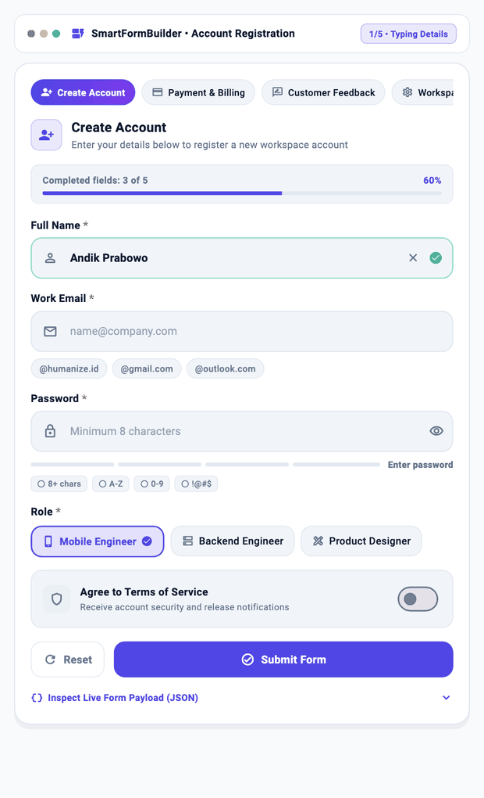
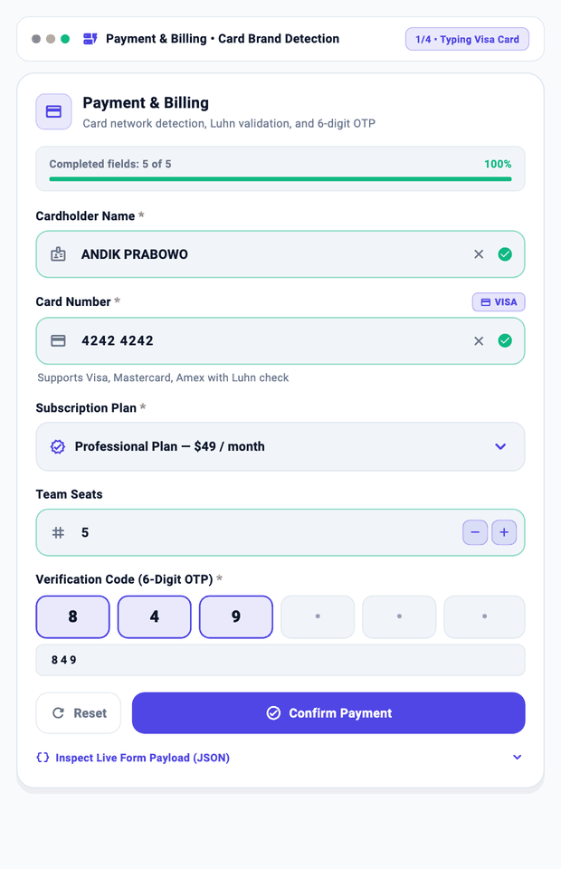
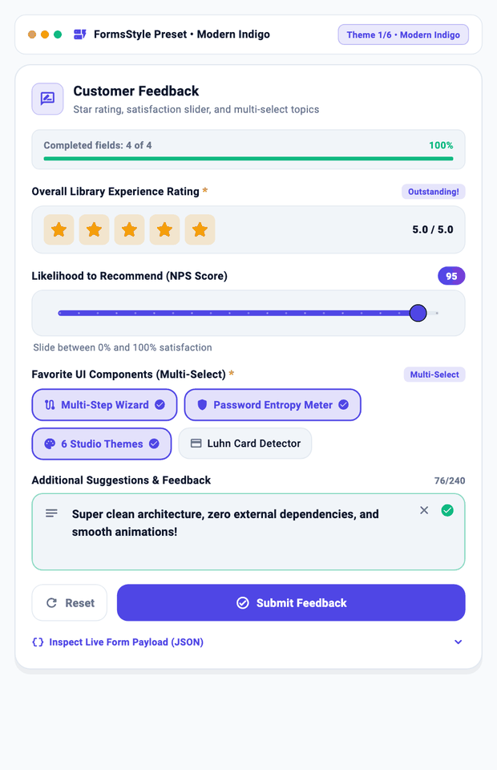

# forms_example

[](https://pub.dev/packages/forms_example)
[](https://opensource.org/licenses/MIT)
[](https://flutter.dev)
[](https://pub.dev/packages/forms_example)
[](https://humanize.id)

A **modern, lightweight, and customizable** Flutter forms library featuring a declarative schema form builder (`SmartFormBuilder`), a 3-step onboarding wizard (`ModernFormStepper`), smart email domain quick-chips, real-time 4-segment password entropy meters, Luhn credit card brand detection (`VISA`, `MASTERCARD`, `AMEX`, `DISCOVER`), segmented 6-digit OTP verification inputs, interactive star ratings, and 6 turnkey studio theme presets. Zero external dependencies and 100% cross-platform support.

> 🌟 Supported & Powered by [Humanize AI](https://humanize.id)

<p align="center">
  
</p>

---

## 🎬 Real Flutter UI Animated Walkthrough

| 1. Account Registration & Password Meter (`SmartFormBuilder`) | 2. Multi-Step Onboarding Wizard (`ModernFormStepper`) |
| :---: | :---: |
|  |  |
| Real-time form completion tracking (`0%` → `100%`), one-tap `@humanize.id` email domain chip, live 4-bar password strength meter (`Weak` → `Strong`), and submission confirmation. | Step-by-step progression across `Account Identity`, `Stack & Capacity`, and `Verify & Launch` with per-step validation gates and multi-select platform chips. |

| 3. Payment Checkout, Luhn Card & 6-Digit OTP (`ModernOtpField`) | 4. Customer Feedback & 6 Theme Presets (`FormsStyle`) |
| :---: | :---: |
|  |  |
| Automatic 4-digit card formatting (`4242 4242 4242 4242`), live `VISA` network badge, instant `LUHN OK` checksum verification, numeric seat stepper, and 6-digit OTP verification. | Interactive 5-star rating bar (`Outstanding!`), smooth NPS satisfaction slider, multi-select feature tags, and live switching across all 6 `FormsStyle` presets. |

---

## ✨ Key Features

- 🧩 **Declarative Schema Form Builder** (`SmartFormBuilder`):
  - Render complete, validated forms from a declarative `List<FormFieldConfig>` or choose from 4 built-in turnkey templates:
    - `FormTemplatePreset.authSignup` — Account registration with smart email chips & password strength meter.
    - `FormTemplatePreset.paymentCheckout` — Payment & billing checkout with Luhn credit card brand detector & 6-digit OTP.
    - `FormTemplatePreset.feedbackSurvey` — Customer feedback with star rating, NPS slider, and multi-select topics.
    - `FormTemplatePreset.profileOnboarding` — Workspace settings with domain URL validation, date picker, and toggles.
  - Built-in **Completed Fields Progress Bar** (`completed of total` valid fields & live percentage) and collapsible **Live JSON Payload Inspector**.
- 🧭 **Multi-Step Validated Form Wizard** (`ModernFormStepper`):
  - Interactive horizontal step indicator bar with emerald checkmarks for completed steps and active step badges.
  - Per-step validation gate ensures all required fields in the current step pass validation before advancing to the next step.
- ⚡ **Smart Input Fields** (`ModernTextField`):
  - **Smart Email Mode** (`FormFieldType.email`): One-tap domain suggestion chips (`@humanize.id`, `@gmail.com`, `@outlook.com`) that auto-complete the user's address.
  - **Password Entropy Meter** (`FormFieldType.password`): Live 4-segment strength progress bar (`Weak`, `Fair`, `Good`, `Strong`) and real-time checklist pills (`8+ chars`, `A-Z`, `0-9`, `!@#$`).
  - **Luhn Credit Card Mode** (`FormFieldType.creditCard`): Automatic 4-digit grouping (`4242 4242 4242 4242`), live network brand badge (`VISA`, `MASTERCARD`, `AMEX`, `DISCOVER`), and instant `LUHN OK` checksum badge.
  - **Numeric Stepper Mode** (`FormFieldType.number`): Integrated `-` / `+` increment buttons with `min`, `max`, and `step` bounds.
- 🎯 **Rich Interactive Selectors**:
  - `ModernChoiceSelector` — Single-select and multi-select animated choice chips with icons.
  - `ModernOtpField` — Segmented 4-digit or 6-digit verification passcode boxes with `VERIFIED` badge.
  - `ModernRatingField` — Interactive 5-star rating selector with dynamic sentiment labels (`Needs Work` to `Outstanding!`).
  - `ModernSliderField`, `ModernSwitchCard`, and `ModernDropdownField`.
- 🎨 **6 Built-in Studio Theme Presets** (`FormsStyle`):
  - `FormsStyle.modernIndigo()` — Crisp SaaS light surface with electric indigo & slate borders.
  - `FormsStyle.cyberDark()` — Obsidian dark surface with cyan (`#00F5D4`) & emerald validation accents.
  - `FormsStyle.glassAurora()` — Midnight aurora palette with sky blue & indigo accents.
  - `FormsStyle.emeraldMinimal()` — Clean fintech mint/emerald theme.
  - `FormsStyle.sunsetWarm()` — Warm coral, amber, and rose consumer palette.
  - `FormsStyle.softNeumorphic()` — Tactile soft-UI surface with dual elevation shadows.

---

## 📦 Installation

Add `forms_example` to your `pubspec.yaml`:

```yaml
dependencies:
  forms_example: ^1.0.1
```

Or install via the Flutter CLI:

```bash
flutter pub add forms_example
```

---

## 🚀 Quick Start

### 1. Turnkey Smart Form Builder (`SmartFormBuilder`)

```dart
import 'package:flutter/material.dart';
import 'package:forms_example/forms_example.dart';

class AccountRegistrationScreen extends StatefulWidget {
  const AccountRegistrationScreen({super.key});

  @override
  State<AccountRegistrationScreen> createState() =>
      _AccountRegistrationScreenState();
}

class _AccountRegistrationScreenState extends State<AccountRegistrationScreen> {
  final controller = FormsController(
    preset: FormTemplatePreset.authSignup,
  );

  @override
  void dispose() {
    controller.dispose();
    super.dispose();
  }

  @override
  Widget build(BuildContext context) {
    return Scaffold(
      backgroundColor: const Color(0xFFF8FAFC),
      body: SingleChildScrollView(
        padding: const EdgeInsets.all(16),
        child: SmartFormBuilder(
          controller: controller,
          style: FormsStyle.modernIndigo(),
          showPresetSelector: true,
          showJsonPreview: true,
          onSubmitted: (result) {
            if (result.isSuccess) {
              debugPrint('Submitted payload: ${result.values}');
            }
          },
        ),
      ),
    );
  }
}
```

---

## 📖 Component Usage Examples

### 2. Multi-Step Onboarding Wizard (`ModernFormStepper`)

```dart
ModernFormStepper(
  title: 'Workspace Onboarding Wizard',
  subtitle: 'Validated step-by-step setup powered by Humanize AI',
  style: FormsStyle.modernIndigo(),
  steps: FormsController.buildDefaultWizardSteps(),
  onStepChanged: (stepIndex) {
    debugPrint('Moved to step: ${stepIndex + 1}');
  },
  onSubmitted: (result) {
    debugPrint('Wizard completed: ${result.values}');
  },
)
```

### 3. Standalone Smart Email & Password Meter (`ModernTextField`)

```dart
Column(
  children: [
    ModernTextField(
      label: 'Work Email',
      type: FormFieldType.email,
      required: true,
      emailDomains: const ['humanize.id', 'gmail.com', 'outlook.com'],
      style: FormsStyle.modernIndigo(),
      onChanged: (email) => debugPrint('Email: $email'),
    ),
    const SizedBox(height: 16),
    ModernTextField(
      label: 'Password',
      type: FormFieldType.password,
      required: true,
      showPasswordMeter: true,
      style: FormsStyle.modernIndigo(),
      onChanged: (password) => debugPrint('Password updated'),
    ),
  ],
)
```

### 4. Auto-Formatted Luhn Credit Card & 6-Digit OTP (`ModernOtpField`)

```dart
Column(
  children: [
    ModernTextField(
      label: 'Card Number',
      type: FormFieldType.creditCard,
      initialValue: '4242 4242 4242 4242',
      required: true,
      style: FormsStyle.modernIndigo(),
    ),
    const SizedBox(height: 16),
    ModernOtpField(
      label: '6-Digit Verification Code',
      length: 6,
      value: '849204',
      required: true,
      style: FormsStyle.modernIndigo(),
      onChanged: (code) => debugPrint('OTP: $code'),
    ),
  ],
)
```

### 5. Custom Declarative Schema & Composable Validators (`FormsValidator`)

```dart
final customController = FormsController(
  fields: [
    FormFieldConfig(
      key: 'username',
      label: 'Username',
      required: true,
      validators: [
        FormsValidator.minLength(4),
        FormsValidator.maxLength(24),
      ],
    ),
    FormFieldConfig(
      key: 'website',
      label: 'Portfolio URL',
      initialValue: 'https://humanize.id',
      validators: [
        FormsValidator.url(),
      ],
    ),
    const FormFieldConfig(
      key: 'satisfaction',
      label: 'Experience Rating',
      type: FormFieldType.rating,
      initialValue: 5.0,
    ),
  ],
);
```

---

## 💖 Support & Sponsor

This open-source library is proudly supported and powered by **[Humanize AI](https://humanize.id)** — an advanced AI platform for natural and human-like content generation.

- **Sponsor & Support**: [Humanize AI](https://humanize.id)
- **Repository**: [https://github.com/andikpbw/flutter-forms-example.git](https://github.com/andikpbw/flutter-forms-example.git)
- **Issue Tracker**: [GitHub Issues](https://github.com/andikpbw/flutter-forms-example/issues)

---

## 📄 License

Released under the [MIT License](LICENSE).
